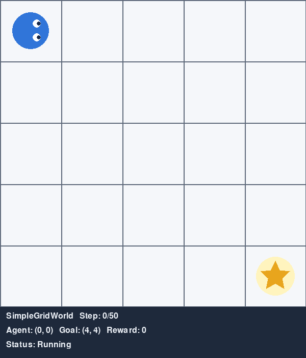

# GridWorld RL Lab · 网格世界与价值迭代

一个从课程练习整理而来的强化学习小项目：用 **Gymnasium** 定义环境，用 **Pygame** 看见状态变化，再用 **价值迭代**计算不同折扣率下的最优状态价值。

[](https://github.com/Eating-King-Git/gridworld-rl-lab/actions/workflows/tests.yml)

<p align="center"></p>

[MP4 演示](docs/media/demo.mp4) · [算法说明](docs/algorithm.md) · [验证记录](docs/validation.md) · [来源与许可](THIRD_PARTY_NOTICES.md)

## 这个项目包含什么

- 5×5 网格环境：观察、动作、奖励、正常终止和时间截断。
- 方向键交互演示：移动、重置和退出。
- 同步价值迭代：比较 γ=0、0.5、0.9，并用解析解和 Bellman 残差检查结果。
- 从计算出的价值表生成贪心策略演示，而不是预录的鼠标操作。
- 环境、事件控制和数学正确性测试，以及 GitHub Actions 检查。

这里实现的是**已知模型上的动态规划**，不是通过采样训练的 Q-learning、SARSA 或深度强化学习。环境、规划算法和交互演示分别位于独立文件，方便对照阅读。

**English:** A compact Gymnasium grid world with keyboard interaction, value iteration, analytical checks, and reproducible visual demonstrations. The planner solves a known deterministic discounted MDP; this is not a learned Q-network. Source comments and documentation are primarily in Chinese.

## 快速开始

本地验证基线：Windows x64、Python 3.10.11。依赖版本见 `requirements.txt`；自动检查工作流配置为 Windows / Python 3.10 与 Ubuntu / Python 3.12，实际运行结果见页面上方的 Tests 徽标。图形窗口需要桌面环境。

在 PowerShell 中：

```powershell
git clone https://github.com/Eating-King-Git/gridworld-rl-lab.git
cd gridworld-rl-lab
python -m venv .venv
.\.venv\Scripts\python.exe -m pip install -r requirements.txt
.\.venv\Scripts\python.exe demo.py
```

不需要激活环境，也不需要更改 PowerShell 执行策略。

Linux/macOS 可使用 `python3 -m venv .venv`，将后续 Python 命令换成 `.venv/bin/python`。macOS 尚未验证。

| 操作 | 按键 |
|---|---|
| 移动 | ↑ / → / ↓ / ← |
| 重新开始 | R |
| 退出 | Esc 或关闭窗口 |

到达目标或步数达到上限后，先按 R 再开始下一局。

## 环境规则

| 项目 | 定义 |
|---|---|
| 地图 | 默认 5×5，无障碍；构造参数可调整大小 |
| 起点／终点 | 左上角 `(0,0)` ／右下角 `(4,4)` |
| 观察 | `{"agent": [行,列], "target": [行,列]}` |
| 动作 | `0=上、1=右、2=下、3=左` |
| 边界 | 越界动作停留原位，仍消耗一步 |
| 奖励 | 进入目标 `+1`，其余 `0` |
| 正常终止 | 到达目标，`terminated=True` |
| 时间限制 | 默认 50 步，未到目标则 `truncated=True` |

环境不使用随机起点；`reset(seed=...)` 保留 Gymnasium 接口。结束后再次调用 `step()` 会报错，调用 `reset()` 开始新回合。

角色和目标全部由本项目代码绘制，没有额外图片资源下载，也不依赖本机中文字体。窗口内使用英文状态文字。

## 计算价值与生成演示

```powershell
.\.venv\Scripts\python.exe value_iteration.py
.\.venv\Scripts\python.exe make_demo_video.py
```

- 价值计算输出到 `examples/value_iteration_results.txt`。
- 演示脚本不弹出窗口，生成 `docs/media/preview.png`、`demo.gif`、`demo.mp4`。
- 可用 `--output <文件>` 或 `--output-dir <目录>` 指定其他位置；默认输出相对于脚本目录，显式相对路径则相对于当前工作目录。

默认网格最短路径是 8 步，起点价值为 `γ⁷`：

| γ | 起点 V*(0,0) | 终点前一格 | 终点 |
|---|---:|---:|---:|
| 0 | 0 | 1 | 0 |
| 0.5 | 0.0078125 | 1 | 0 |
| 0.9 | 0.4782969 | 1 | 0 |

**价值迭代忽略演示的 50 步截断，计算无限时域折扣模型中的价值。** 它不是带“剩余步数”的有限时域价值表。例如把回合上限改成 1，并不意味着起点仍能在那一回合到达目标。详见[算法与时间限制](docs/algorithm.md)。

## 测试

```powershell
.\.venv\Scripts\python.exe -m unittest discover -v
.\.venv\Scripts\python.exe -m pip check
```

测试使用 SDL dummy 驱动处理无窗口渲染和按键事件，不需要连接显示器或音频设备。可以单独运行 `test_env.py`。当前测试范围和实际验证结果见[验证记录](docs/validation.md)，云端结果以 [Actions](https://github.com/Eating-King-Git/gridworld-rl-lab/actions) 为准。

## 目录

```text
simple_grid_world.py       环境与绘制
value_iteration.py         规划、理论解、残差与结果输出
demo.py                    键盘演示
make_demo_video.py         贪心策略演示素材生成
test_*.py                 自动测试
examples/                 可重算的文本结果
docs/                     算法、验证与演示
```

## 项目背景与边界

这是从个人课程工程整理出的学习作品。整理工作包括环境接口、可视化、价值迭代与理论核验、交互控制测试、独立运行说明及自动检查，使用了 AI 辅助整理、开发和复核。不声称提出新算法，也不将课程参考包作为独立原创成果发布。

首版没有障碍物、随机地图、策略训练或多智能体；后续可以在保持测试可复现的前提下扩展。欢迎用最小复现说明问题，避免上传个人作业封面或私人资料。

项目代码与文档采用 [MIT License](LICENSE)。Gymnasium 等依赖保留各自许可，参考来源和基础接口的上游声明见 [THIRD_PARTY_NOTICES.md](THIRD_PARTY_NOTICES.md)。
